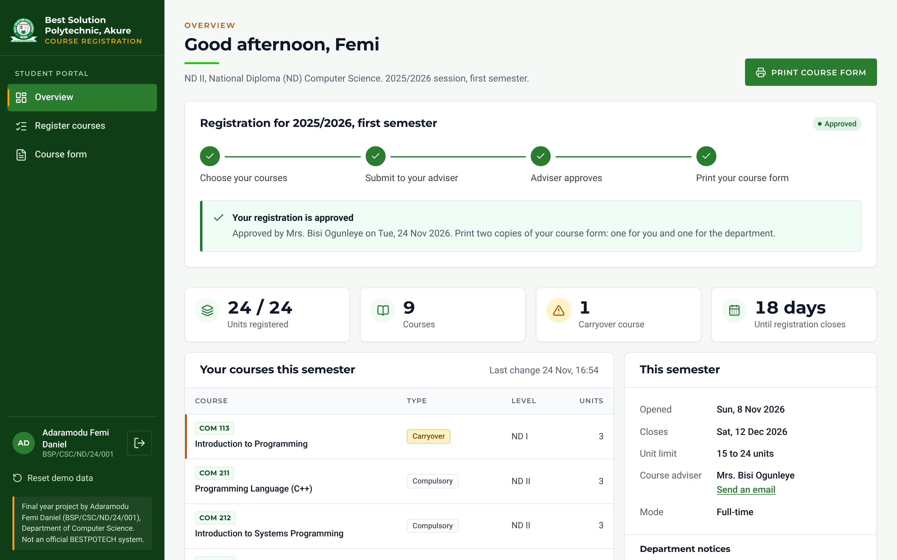
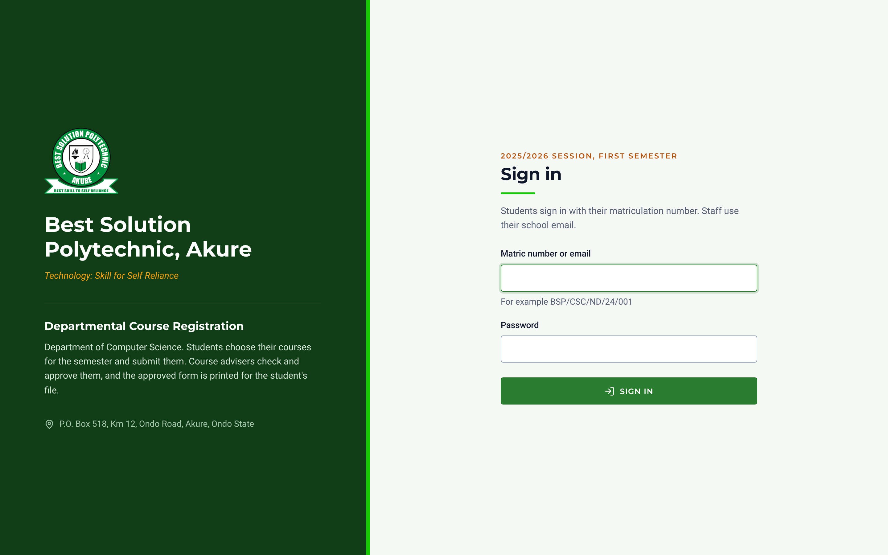
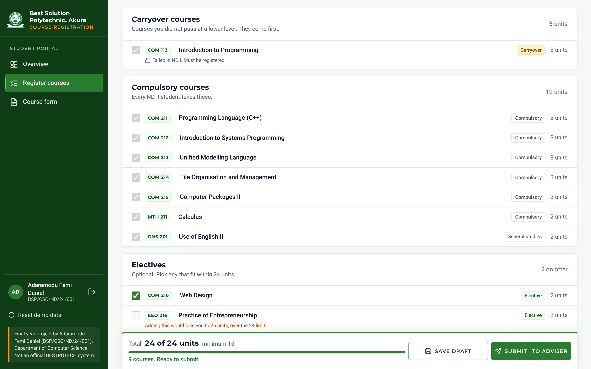
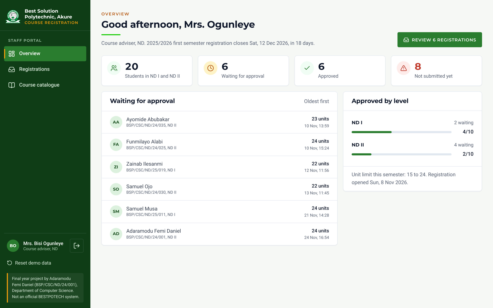
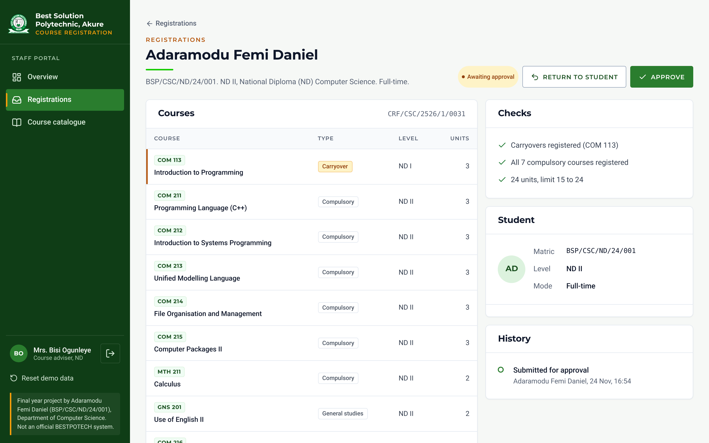
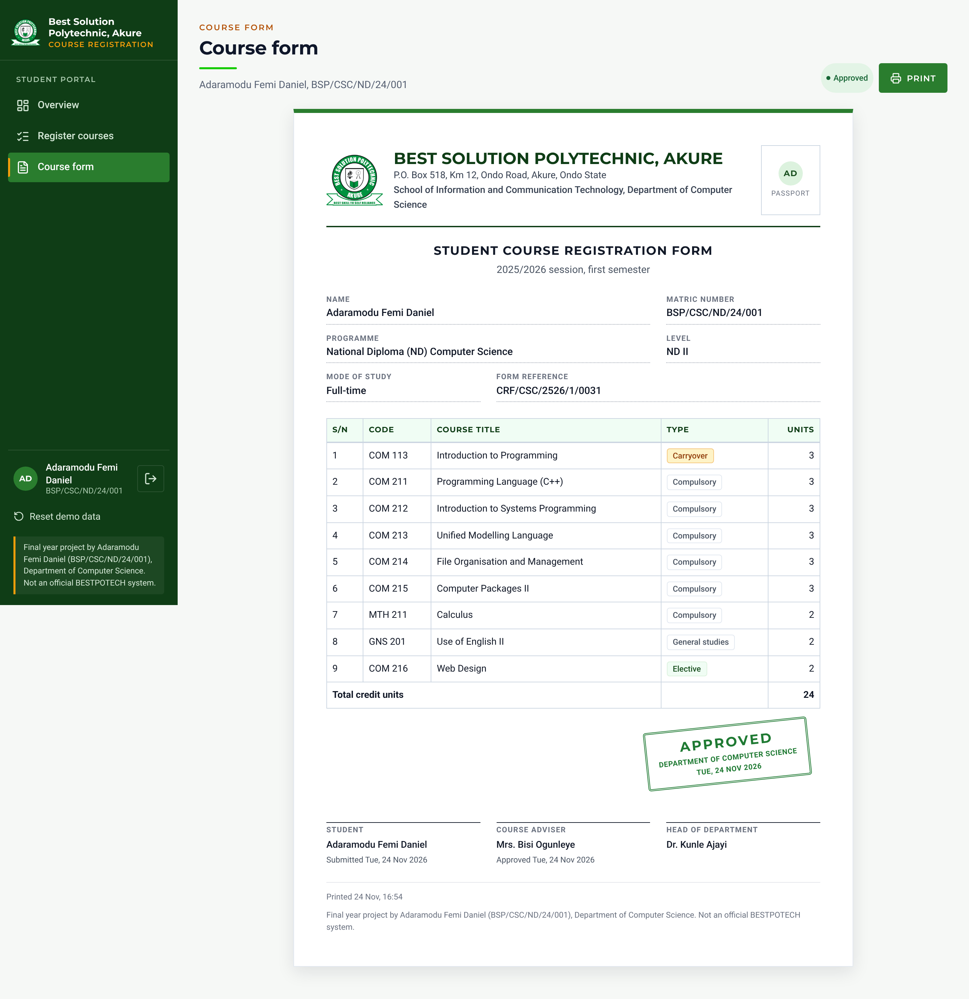
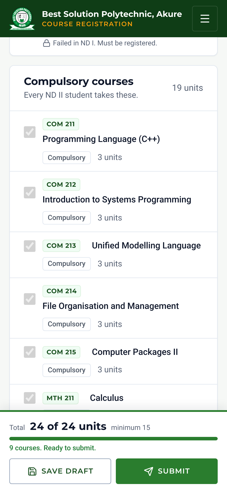
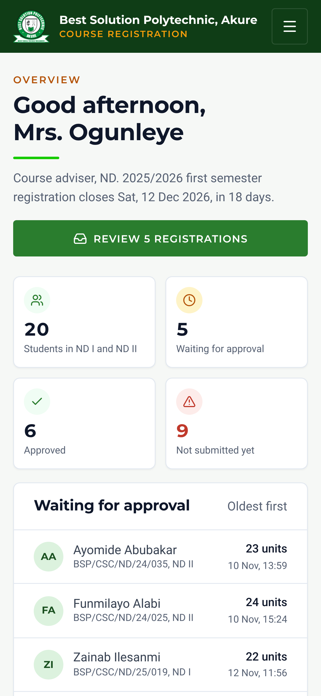

# Departmental Course Registration

Course registration for the Department of Computer Science, built as a final year project for Best Solution Polytechnic, Akure. Students choose their courses for the semester and send them to their course adviser. The adviser checks them and approves them, or sends them back with a note. The approved course form prints on one A4 page.

**Presented by:** Adaramodu Femi Daniel (BSP/CSC/ND/24/001), Department of Computer Science.

**Live demo:** https://joyhacks.github.io/course-registration-system/



## Try it

Every demo account uses the password `demo2026`. Type the matric number or email below into the sign-in form.

| Account | Sign in with | What to try |
|---|---|---|
| Adaramodu Femi Daniel, student, ND II | `BSP/CSC/ND/24/001` | Register courses (one carryover is already in), submit, then print the form after approval |
| Mrs. Bisi Ogunleye, course adviser, ND | `b.ogunleye@demo.school` | Approve or return the registrations waiting for you |
| Mr. Segun Falade, course adviser, HND | `s.falade@demo.school` | Same, for HND I and HND II |
| Dr. Kunle Ajayi, Head of Department | `hod.cs@demo.school` | See and review every level |

A good walk-through takes two minutes:

1. Sign in as Femi. Add an elective and submit.
2. Sign out and sign in as Mrs. Ogunleye. Open Femi's registration, check the automatic checks, and approve it.
3. Sign in as Femi again and print the course form.

**Reset demo data** at the bottom of the menu puts everything back to the start.

## Screens

| | |
|---|---|
|  |  |
|  |  |

The printed course form, with the approval stamp:



On a phone:

 

## What it does

**Students**
- See where their registration stands: a four-step tracker from choosing courses to printing the form.
- Get their carryover and compulsory courses ticked and locked in. They only choose electives.
- Watch a running unit total. An elective that would go over the 24 unit limit can't be ticked, and the reason is shown under it.
- Save a draft and come back later, or submit to their adviser.
- Read the adviser's note if the registration comes back, fix it and submit again.
- Print the approved form: school crest, student details, every course with its units, signature lines for student, adviser and HOD, and an approval stamp. Before approval it is marked as not valid.

**Course advisers and the HOD**
- See how many students are waiting, approved and not yet submitted, and progress for each level they advise.
- Filter all registrations by status and level, and search by name or matric number. Filters stay in the link.
- Open a registration and see the checks done for them: carryovers present, compulsory courses present, units within the limit.
- Approve, or return with a required note. An approval can be undone the same way.
- Browse the course catalogue for every level and both semesters.
- An adviser only sees the levels they advise. The HOD sees every level.

## The rules

Kept in one file, [`js/lib/rules.js`](js/lib/rules.js), with no browser code, so the tests run them directly:

- Carryover courses (failed at a lower level) must be registered, and they count towards the unit limit.
- Every compulsory and general studies course for the level must be registered.
- Total credit units must be between 15 and 24.
- Courses from another level can't be added, and nothing can be listed twice.
- Nothing can be saved or submitted outside the registration window.
- Once submitted, only the adviser can send it back. Once approved, it is locked.
- Only an adviser for the student's level, or the HOD, can approve or return it. A return needs a note.
- Each submitted form gets a reference like `CRF/CSC/2526/1/0031`, kept if it is returned and resubmitted.

## How the demo works

There is no server and no database. This version runs entirely in the browser so it can be hosted for free and shown anywhere.

- [`js/lib/catalogue.js`](js/lib/catalogue.js) holds the course catalogue (ND I to HND II, both semesters) and the staff accounts.
- [`js/lib/seed.js`](js/lib/seed.js) builds 40 students with registrations at every stage. The names come out the same every time; the dates move so the registration window is always open on the day of the demo.
- [`js/lib/store.js`](js/lib/store.js) keeps that data in `localStorage`. Every change goes through the rules first, so the screens can't save something the rules would refuse.
- Each visitor has their own copy. Changes stay in that browser until **Reset demo data**.

Because it is a demo, sign-in is checked in the browser against one shared password. A real deployment would move `store.js` behind a server with a database and proper password hashing; the pages and rules would not need to change. The [attendance register](https://github.com/Joyhacks/school-attendance-register) by the same author shows that server side (Node.js, Express, MySQL).

## Run it locally

Any static file server works. With Python:

```bash
git clone https://github.com/Joyhacks/course-registration-system.git
cd course-registration-system
python3 -m http.server 8080
```

Then open http://localhost:8080. Opening `index.html` straight from the file system will not work, because browsers block JavaScript modules on `file://` pages.

Run the tests (Node.js 18 or newer, nothing to install):

```bash
npm test
```

## Project structure

```
index.html            Sign in
student.html          Student overview
register.html         Course picker
form.html             Printable course form
adviser.html          Staff overview
registrations.html    All registrations with filters
review.html           Review one registration
catalogue.html        Course catalogue
css/                  Design tokens, shared components, registration screens and print styles
js/lib/               Rules, demo data, storage, page frame and shared interface pieces
js/pages/             One script per page
tests/                Rule tests (node --test)
```

## Built with

HTML, CSS and JavaScript modules. No framework, no build step and no dependencies. Fonts (Montserrat, Roboto) and icons (Lucide) are bundled, so the site makes no outside requests. A Content Security Policy blocks inline scripts and styles. Pages were checked with axe for WCAG 2.2 AA on desktop and phone sizes.

## Notes

The crest and name belong to Best Solution Polytechnic, Akure, and are used here for a student project. Every page says it is not an official school system. Student and staff names are made up. Course codes follow the usual layout of an NBTE Computer Science curriculum, not the school's own course list.

## Licence

MIT. See [LICENSE](LICENSE).
